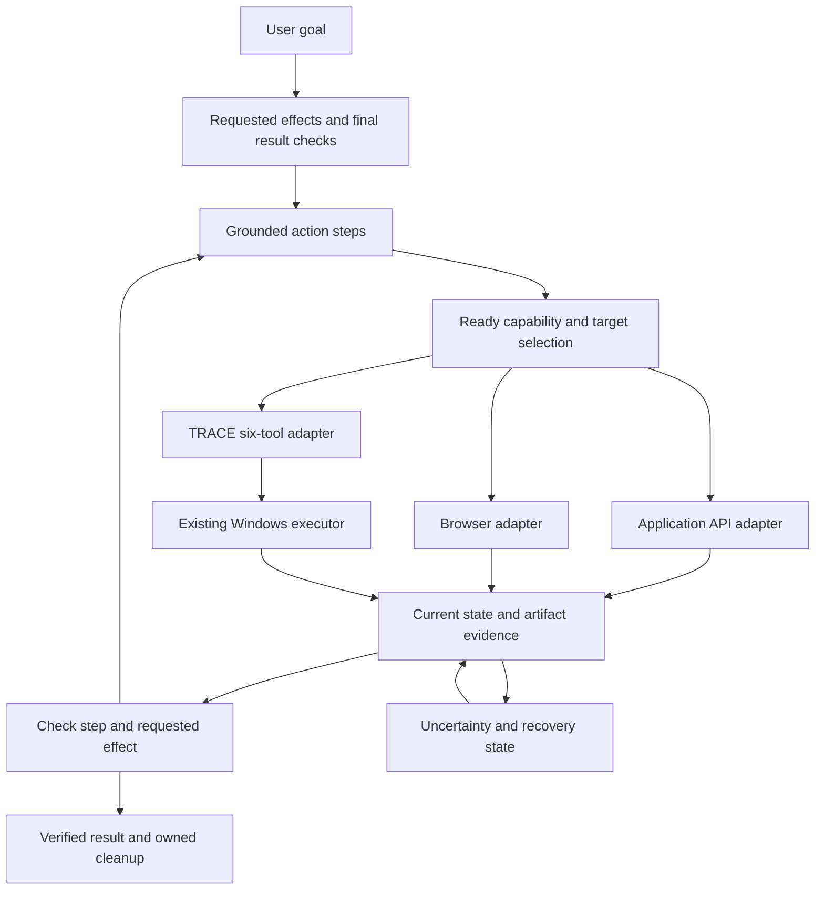

# Bringing the computer-use method into TRACE

**Status:** retained design baseline, with implementation now underway. Read [the current gap-closure checkpoint](GAP_CLOSURE_STATUS.md) and [actual method API](../src/method/README.md) for present capabilities and evidence. The method and browser adapters have been imported, and the canonical guidance bundle is installed. Native acceptance and other required capabilities remain incomplete; the plan below is not a declaration of completed parity.

The original source audit began on 20 October 2026 at `cd1feff37b455c8ae0c0f7733b25dbc1ec9f4dbb`. The following pre-implementation comparisons and proposed layout are retained as design context; current source and receipts supersede their status descriptions.

## What this would achieve

The standalone `computer-use-method` work can become TRACE's workflow layer: choosing a usable tool, keeping track of a task across applications, grounding each action, checking the result, and continuing after interruptions. It belongs within TRACE's existing **Computer Use** capability. It should reuse the Windows executor and preserve its six MCP tools.

Importing the prototype alone will **not close the full practical gap with the inspected Claude system**. The prototype supplies an original coordination model and tests. Browser execution, application lifecycle, clipboard handling, and real workflow acceptance still need implementation or a connected host adapter. Several prototype assumptions also need correction before promotion.

The objective is to close the observed usability and workflow gaps through original TRACE implementations. No Claude application permission tiers or additional per-app grant flow are proposed. Existing host authorization, exact target ownership, and input recovery remain applicable.

## What is already part of TRACE

| Component | Current position |
| --- | --- |
| Windows execution | Already in TRACE: diagnostics, exact-window discovery/session, PNG/UIA observation, actions and release |
| Targeting improvements | Current source accepts observation depth 1–32/default 8, retains depth for action validation, and distinguishes proven primary non-dispatch from uncertain delivery |
| Native reliability work | Governed by the existing A31/A32/A33 requirements and their individual receipts; this plan does not mark them complete |
| Method engine and adapter | Separate prototype in the standalone vault; not imported into TRACE |
| Rebuilt method skill | Staged in the standalone vault; not installed and not merged with the canonical TRACE skill |
| Knowledge vault and explorer | Separate local research artifacts; useful implementation evidence, not runtime dependencies |

The standalone validation recorded **44 passing simulated/protocol-shaped tests**. Its real stdio probe established six-tool discovery and reported readiness. It did not exercise a live application task. Those results do not establish host compatibility, modal handling, physical input recovery, or feature parity.

The vault was initially researched against `f927c60`. Some gap descriptions are historical: depth handling and the top-level outcome contract have since changed in TRACE. Adapt the method to the current executor rather than reimplementing those fixes.

## What to add

| Addition | What it does | Why it matters |
| --- | --- | --- |
| Capability registry and routing | Matches each operation to an actually ready app, browser or native provider in the intended environment | Avoids unnecessary pixel input, unsupported operations and wrong-host assumptions |
| Goal/effect/step coordinator | Tracks requested effects, their individual action steps, expected results and cleanup | Prevents omitted requirements and supports tasks needing more than one action |
| Current TRACE adapter | Composes the existing six tools, passes observation depth and preserves outcomes, preparation and recovery evidence | Connects the method to TRACE without creating a second native executor |
| Public focus and constraint evidence | Returns available focus provenance and machine-readable native input limits | Gives agents the information needed to select the right control and supported operation |
| Window/dialog transitions | Releases the previous lease, discovers the exact related target, observes it and returns to the parent | Supports genuine modal workflows without confusing a blocked parent with failed physical cleanup |
| Task checkpoints | Saves minimal structural state, attempts, uncertain effects and target bindings | Resumes from observed reality instead of repeating the last operation |
| Typed artifact handoffs | Checks environment, source/destination, size and content identity | Makes generated files usable across apps and prevents local paths being assumed remote |
| Browser adapter | Supplies real tab discovery, structured reads, navigation/forms, debugging and owned-tab cleanup | Closes the major browser capability gap that instructions alone cannot close |
| Application/clipboard adapters | Support known app/document lifecycle and verified clipboard transactions where needed | Completes native cross-app workflows while preserving user resources and clipboard state |
| Agent guidance and installation | Makes the method discoverable through the canonical TRACE Computer Use skill, with its references | Turns the design into consistent host behavior |

Use available host connectors when they support the exact requested operation. A registry entry must not imply that a connector or browser runtime is installed. Dedicated adapters remain responsible for execution and trustworthy observations.

## How the parts fit together



The model plans and interprets semantic results. The coordinator maintains state and dispatch rules. The provider performs the operation. Verification establishes whether the requested effect happened. The native executor continues to own its window/input validation and recovery responsibilities.

For example, “write a report and save it” is one requested effect with several steps: discover the document, focus the editor, enter text, invoke Save, handle a native dialog if necessary, and inspect the saved artifact. A successful typing call does not complete the saved-report effect. Each step gets its own observation and retry history.

## Fix before importing the prototype

### Separate effects, steps and retries

The prototype counts every input against one task's two-attempt ceiling. That is too small a model for focus → type → save. Introduce a requested effect containing multiple steps. Limit corrective retries per step, after changed evidence; do not count a normal next step as a retry. Complete the effect only after its final predicate passes.

Preserve uncertainty at the step that dispatched. If saving may have succeeded before a capture failed, inspect the document/file before deciding to submit Save again. A checkpoint must retain that unresolved step and its parent effect.

### Separate target blockage from physical cleanup failure

The prototype adapter maps `window_blocked` into quarantine. Its coordinator then blocks another target in that environment, while its recovery method requires input-release evidence the TRACE adapter does not supply. A normal parent → enabled dialog transition can therefore dead-end.

Treat known `not_dispatched` target blockage as a targeting condition when physical cleanup is not required. Preserve the parent effect, release its session, discover the exact owned dialog, observe it and continue. True input recovery uncertainty must still stop native mutation across that affected desktop. Neither a provider change nor a new process may clear that uncertainty.

Independent API work can proceed only when it neither sends input to the affected desktop nor changes or depends on the unresolved effect. The coordinator must represent that distinction; the prototype's coarse environment guard is not a complete production policy.

### Bind to the current observation contract

The standalone adapter was written against an earlier source baseline. Add observation-depth configuration and pass it only to `trace_computer_observe`; the server retains the effective depth for actions. Read the live schemas and reject unsupported fields.

Keep top-level primary outcome, preparatory activation/restoration, resulting state and recovery evidence separate. Do not collapse a proven rejection into uncertainty or reinterpret possible dispatch as safe non-delivery.

Public focus remains a separate source gap: the backend captures and checks it, but the controller's public observation omits that envelope. Expose available focus evidence with provenance or an unavailable reason. Do not substitute foreground-window identity for intended-control focus.

### Preserve coordinates and recovery boundaries

Keep TRACE's default coordinate contract: physical pixels relative to the original observed window image. The standalone geometry helper returns physical screen coordinates. Its output requires an explicit, current-frame conversion before it can become a TRACE action. Reject stale frames and undeclared coordinate spaces; introduce no guessed DPI scaling.

Coordinator quarantine/checkpoint tests do not establish physical mouse/key release, a durable cross-process watchdog or native crash safety. Reuse and complete the existing native acceptance contract rather than claiming those guarantees from method tests.

## Proposed repository layout

These are proposed destinations, not files added by this plan:

```text
src/method/
  index.cjs                    Public library entry
  coordinator.cjs              Goal/effect/step state and continuation
  capabilities.cjs             Ready-provider operation matching
  trace-adapter.cjs            Adapter to the current six MCP tools
  geometry.cjs                 Explicit optional frame conversion
tests/
  method-coordinator.test.cjs
  method-trace-adapter.test.cjs
  method-geometry.test.cjs
  method-installation.test.cjs
examples/
  computer-method.cjs          Explicitly labeled simulation
scripts/
  smoke-computer-method.cjs    Read-only real protocol verification
skills/trace-computer-use/
  SKILL.md                    Canonical combined guidance
  references/
    readiness-routing.md
    operation-and-recovery.md
    acceptance.md
docs/
  COMPUTER_USE_METHOD.md       Public usage and actual limits
```

Promote only original method code and portable documentation. Keep the personal vault, raw package analysis, machine-specific paths, private screenshots and vendor materials outside Git. Preserve sanitized evidence appropriate to the repository's rules.

Start with a library and injected provider adapters. An additional CLI can follow if it serves a concrete host workflow; there is no current `trace method` command. Avoid introducing another MCP server or changing the six native tools merely to expose orchestration.

Merge method guidance into the existing `trace-computer-use` skill so native instructions remain canonical. Do not install a competing skill with divergent recovery rules. Keep the current targeting edits and any verified native guidance.

## Skill installation needs a bundle upgrade

The current configuration path copies `SKILL.md`; the current synchronization script rejects unexpected content such as reference directories. Adding Markdown links without updating installation would leave installed skills incomplete.

Extend plan/apply and synchronization to handle an explicit manifest of TRACE-owned skill files. The plan must list added/changed files and per-file hashes. Preserve exact backups; check destinations and source state before writes; retain conflicting/user-owned content; verify the whole installed bundle and discovery copies. Test idempotence, partial failures and full rollback. Do not use recursive replacement of an arbitrary skill directory.

This preserves existing setup behavior while making the new references usable in each supported host. Configuration presence still requires a separate host discovery test.

## Integration sequence and proof

| Phase | Work | Required proof before calling it complete |
| --- | --- | --- |
| 1. Import and harden the method | Add the library, current adapter and explicit effect/step model; fix modal and uncertainty handling | Existing prototype cases still pass; three-step effect, genuine targeting transitions, failed refresh, uncertain dispatch and restart cases pass |
| 2. Package guidance | Merge canonical skill and add manifest-based reference installation | Complete bundle installed/discovered; backups, conflicts, idempotence and rollback verified |
| 3. Connect real providers | Bind current TRACE transport and at least one real structured browser provider; use actual available app APIs | Real tool discovery and separate native/browser operations show independently checked results |
| 4. Close cross-app gaps | Add typed app lifecycle/artifact/clipboard operations needed by representative tasks | Known app/document launch/attach, exact dialog handoff, clipboard restoration and received-file identity verified |
| 5. Demonstrate whole workflows | Run separate Codex and Claude tasks and the owned synthetic REPLAY case | Every requested effect and final artifact verified; failed-action recovery and owned cleanup recorded |
| 6. Release readiness | Reconcile specification, docs, versions, clean installation and CI | Existing release gates pass; no method test substitutes for missing native/host evidence |

Phases beyond the currently authorized alpha.3.3 implementation are proposed future work. This document does not amend milestone scope or promote an unfinished milestone. Use focused PRs targeting two or three commits, with four as the maximum; finish one dependency before stacking another.

The acceptance suite must include:

- **METHOD-EFFECT:** focus, type and save are separate grounded steps; only the verified saved artifact completes the user effect.
- **METHOD-MODAL:** a proven non-dispatched parent rejection permits exact owned-dialog handoff; true recovery uncertainty remains blocked.
- **METHOD-OBSERVE:** depth-12 targeting works through the adapter; failed refresh invalidates prior evidence; changed focus/identity rejects stale input.
- **METHOD-OUTCOME:** preparation and primary dispatch remain distinct; a lost post-action receipt does not cause duplicate submission.
- **METHOD-RESUME:** uncertain effects, retry budgets and canonical target identity survive restart; replaced process/window binding is rejected.
- **METHOD-ROUTE:** provider readiness, target environment and operation support determine the route; unsupported work remains visibly incomplete.
- **METHOD-HANDOFF:** a file with spaces/Unicode is verified at the receiving environment by content identity; wrong or missing bytes fail.
- **METHOD-OWNERSHIP:** native leases release before transitions; failed cleanup persists; attached user resources remain open.
- **METHOD-BROWSER:** real structured reads, forms/navigation, tab ownership and diagnostics complete a task with an exact checked result.
- **METHOD-INSTALL:** references arrive with the skill in supported hosts and restore correctly on rollback.

Declare targets, initial state, actions, expected results and cleanup before each live case. Retain failed attempts and the specification's bounded retry budget. A readiness response or fixture pass cannot replace a real workflow receipt.

## Definition of the gap being closed

The method integration closes the **coordination gap** when an agent can use the canonical skill and runtime library to complete a multi-step, multi-target goal, retain uncertainty, and resume without duplicated effects.

The **practical capability gap** is closed only for explicitly tested task classes that also have real execution adapters and verified native/browser behavior. Browser tools, application lifecycle, clipboard handling and physical recovery must exist and pass their own cases. The inspected Claude package is a bounded reference; static inspection does not establish every Claude feature or behavior for comparison.

Until those cases pass, describe the result as an integrated method with a specific coverage list. Do not claim general Claude parity or that the research vault alone made TRACE a complete autonomous operator.

## Source and implementation references

- [Current acceptance specification](../SPEC.md) and [normal-desktop plan](V0.1-PLAN.md).
- [Computer Use operation/setup](COMPUTER_USE.md) and [current canonical skill](../skills/trace-computer-use/SKILL.md).
- [Public MCP schema](../src/computer/server.cjs), [controller observation/outcomes](../src/computer/controller.cjs), and [native backend](../src/computer/winapp-backend.cjs).
- [Configuration installer](../src/computer/configuration.cjs) and [skill synchronizer](../scripts/sync-computer-skill.cjs).
- [Repository rules](../RULES.md), [version control](../VERSION_CONTROL.md), and [provenance](PROVENANCE.md).
- The separate `computer-use-method` vault contains the original lab, rebuilt skill, validation receipts and detailed local source map. It remains a research reference rather than a checkout dependency.
